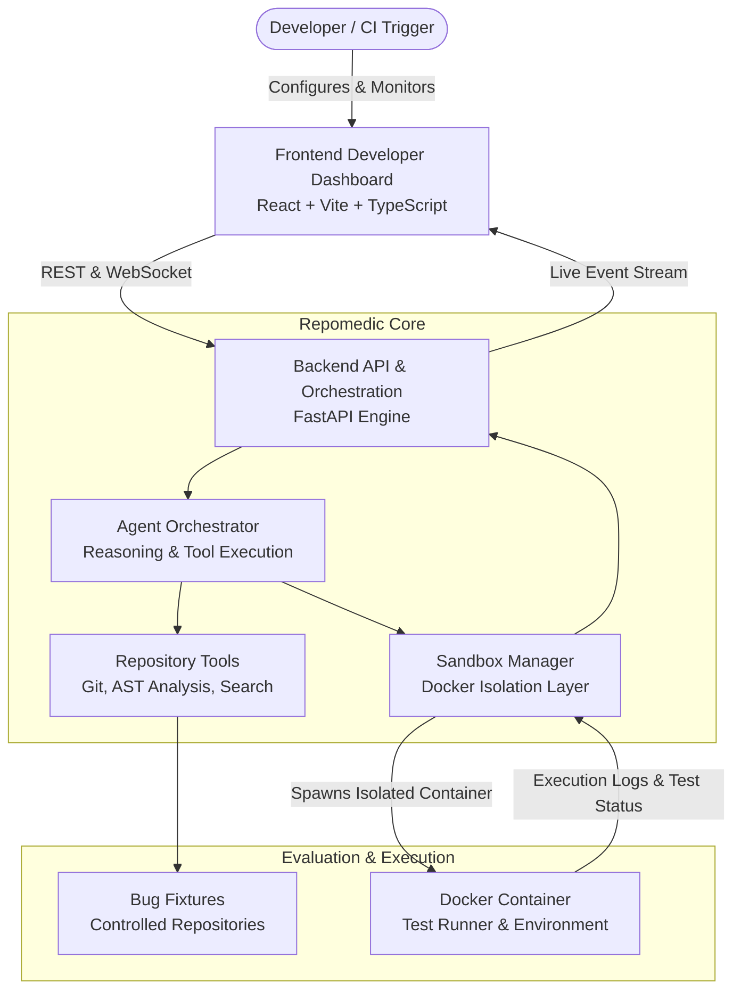
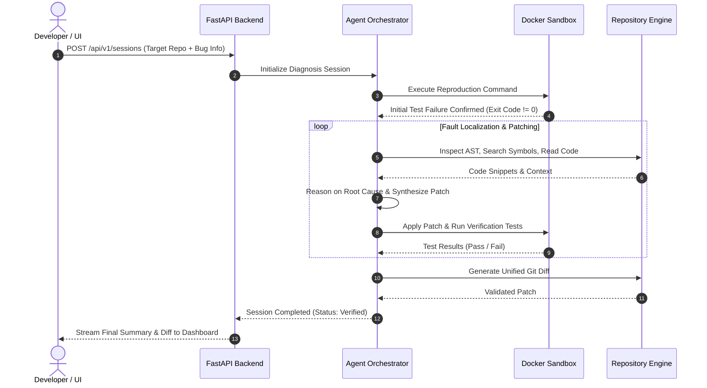

# Repomedic Architecture Documentation

## 1. System Overview

**Repomedic** is an agentic software debugging, repair, and verification platform. It autonomously reproduces software bugs from issue descriptions or bug fixtures, performs fault localization across repositories, synthesizes candidate patches, and verifies fixes inside isolated execution sandboxes before generating pull requests.



---

## 2. Monorepo Structure

Repomedic is organized as a clean, decoupled monorepo:

```
repomedic/
├── frontend/               # React + TypeScript developer dashboard (Vite)
├── backend/                # FastAPI application, agent orchestration & repository tools
├── fixtures/               # Test suites and reproducible bug repositories
│   └── bugs/               # Controlled benchmark fixtures with known bugs
├── docs/                   # Architectural decisions and API contracts
│   ├── architecture.md     # System architecture and design decisions
│   └── api-contract.md     # REST and WebSocket specifications
├── scripts/                # Development, test, and container helpers
├── .github/                # CI workflows and issue templates
│   └── ISSUE_TEMPLATE/
├── .gitignore
├── .env.example
├── docker-compose.yml
└── README.md
```

Each component is modular:
- **Frontend** can be developed and served independently on port `5173`.
- **Backend** can run locally via `uvicorn` on port `8000` or within containers.
- **Fixtures** provide deterministic benchmarks for debugging agents without requiring live external network access.

---

## 3. Component Deep Dive

### 3.1 Frontend (Developer Dashboard)
- **Framework**: React 19 + TypeScript + Vite.
- **Role**:
  - Provides real-time visibility into the agent's thought process, tool invocations, and sandbox test outputs.
  - Displays code diffs and patch comparisons with syntax highlighting.
  - Allows developers to select bug fixtures, configure reproduction commands, and manually inspect verification runs.
  - Communicates with the backend via REST (configuration & session control) and WebSockets (live execution events).

### 3.2 Backend (FastAPI & Agent Orchestration)
- **Framework**: FastAPI (Python 3.12+), Uvicorn, Pydantic v2.
- **Role**:
  - **Session Manager**: Manages diagnosis lifecycle, persists session state, and streams telemetry.
  - **Agent Loop**: Coordinates LLM reasoning loops, tool dispatch (grep, read, file edit, command execution), and error recovery.
  - **Repository Tools**: Safe filesystem and Git operations (branch switching, AST parsing, symbol resolution, diff generation).
  - **Event Bus**: Emits structured timeline events to connected WebSocket clients.

### 3.3 Sandbox Execution Layer
- **Technology**: Docker / Containerized sandboxes.
- **Role**:
  - Executes untrusted user code and reproduction scripts in strict, resource-constrained, network-isolated environments.
  - Captures stdout/stderr, return codes, and test framework output (pytest, jest, cargo test, etc.).
  - Guarantees clean state by creating ephemeral overlay layers or temporary containers for each verification run.

### 3.4 Fixtures & Evaluation
- **Path**: `fixtures/bugs/`
- **Role**:
  - Houses reproducible bug repositories across various languages (Python, TypeScript, Go).
  - Each fixture contains a `fixture.json` descriptor with failure expectations, reproduction commands, and reference patches.
  - Serves as the ground truth benchmark for Repomedic's repair capabilities.

---

## 4. Agent Repair Workflow



---

## 5. Security & Isolation Considerations

1. **Sandbox Containment**: Code executed during reproduction and verification runs inside isolated containers without host filesystem mounting.
2. **Resource Limits**: Sandboxes enforce memory limits, CPU quotas, and execution timeouts to prevent denial-of-service from infinite loops or runaway processes.
3. **Network Constraints**: Test execution containers run with network disabled (`network_mode: none`) unless external package installation is explicitly whitelisted during setup.
